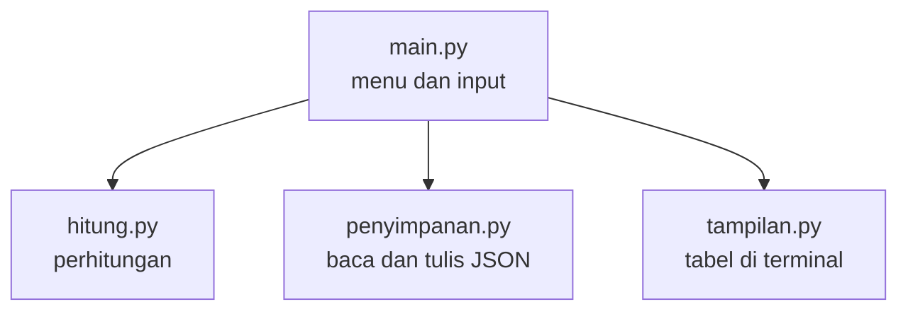

# Arsitektur Patungan

Programnya dibagi jadi empat bagian, dan tiap bagian punya satu tugas aja. Jadi anggota kelompok bisa ngerjain file yang beda tanpa bentrok.

| File | Tugasnya | Boleh baca input? |
| --- | --- | --- |
| `main.py` | Jalanin menu dan nerima input | Boleh |
| `patungan/hitung.py` | Ngitung saldo dan pelunasan | Nggak |
| `patungan/penyimpanan.py` | Baca dan tulis file JSON | Nggak |
| `patungan/tampilan.py` | Nampilin tabel | Nggak |

## Cara ngitungnya

1. Tiap pengeluaran dibagi rata ke orang yang ikut. Uangnya pakai bilangan bulat, jadi nggak ada desimal yang bikin pusing.
2. Yang bayar dapet saldo positif, yang ikut dapet saldo negatif sebesar bagiannya.
3. Orang dengan utang paling gede dipasangin sama orang yang paling banyak harus nerima uang, terus diulang sampai semua saldo jadi nol.
