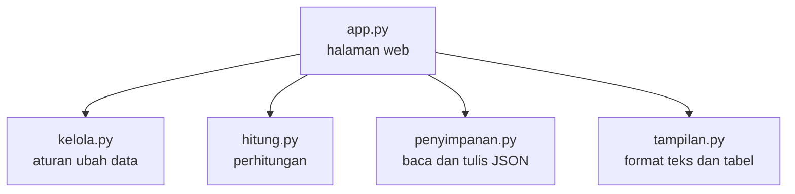

# Arsitektur Patungan

Patungan itu web app yang seluruhnya ditulis pakai Python dengan Streamlit. Kodenya dibagi per tugas, jadi tiap anggota bisa ngerjain file yang beda tanpa bentrok.

| File | Tugasnya | Boleh pakai Streamlit? |
| --- | --- | --- |
| `app.py` | Bikin halaman, form, dan tombol | Boleh |
| `patungan/kelola.py` | Ngecek input dan ngubah data | Nggak |
| `patungan/hitung.py` | Ngitung saldo dan pelunasan | Nggak |
| `patungan/penyimpanan.py` | Baca dan tulis file JSON | Nggak |
| `patungan/tampilan.py` | Nyiapin teks dan isi tabel | Nggak |

Cuma `app.py` yang kenal Streamlit. Bagian lainnya Python biasa, jadi gampang dites.

## Yang terjadi pas tombol dipencet

Streamlit bakal ngejalanin ulang `app.py` dari atas tiap ada interaksi. Alurnya gini:

1. `app.py` baca data dari file JSON.
2. Pas form dikirim, `kelola.py` ngecek input dan ngubah data.
3. Kalau inputnya salah, halaman nampilin pesan error.
4. Kalau bener, data disimpen dan halaman dimuat ulang.

## Cara ngitungnya

1. Tiap pengeluaran dibagi rata ke orang yang ikut. Uangnya pakai bilangan bulat, jadi nggak ada desimal yang bikin pusing.
2. Yang bayar dapet saldo positif, yang ikut dapet saldo negatif sebesar bagiannya.
3. Orang dengan utang paling gede dipasangin sama orang yang paling banyak harus nerima uang, terus diulang sampai semua saldo jadi nol.
